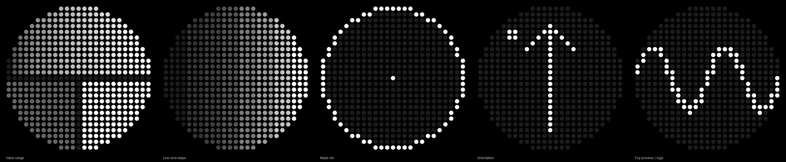

# GlyphWave

A live music visualizer for YouTube Music on the **Nothing Phone (3) Glyph Matrix**, packaged as a Glyph Toy,
with media and visualizer controls on **long presses** of the Glyph Button.

> Status: **Phase 0**. Scaffold, the Glyph Toy with hardware diagnostic patterns, and a raw Glyph Button
> event logger. The full README (screenshots, previews) comes in Phase 6.



## Build & install

Requirements: JDK 17+, Android SDK (platform 37), a Nothing Phone (3) with USB or wireless debugging.

1. Get the Glyph Matrix SDK (not redistributable). See [`app/libs/README.md`](app/libs/README.md):
   ```bash
   git clone --depth 1 https://github.com/Nothing-Developer-Programme/GlyphMatrix-Developer-Kit
   cp GlyphMatrix-Developer-Kit/glyph-matrix-sdk-2.0.aar app/libs/GlyphMatrixSDK.aar
   ```
2. Build and install:
   ```bash
   ./gradlew assembleDebug
   adb install -r app/build/outputs/apk/debug/app-debug.apk
   ```
3. Enable Glyph debug mode (it expires after 48 h, so re-run it if the toy stops responding):
   ```bash
   adb shell settings put global nt_glyph_interface_debug_enable 1
   ```
4. Open GlyphWave → **ADD TO GLYPH TOYS**, then move GlyphWave to *Active*.
5. Logs: `adb logcat -v monotonic -s GlyphWave:V`

## Without an Android SDK

The pure-Kotlin core (mask, canvas, DSP, gestures, modes) builds and tests on any JVM:

```bash
./gradlew -Pglyphwave.coreOnly=true :core:test :core:renderPreviews
# PNGs → core/build/matrix-previews/
```

## Project docs
- [`CLAUDE.md`](CLAUDE.md): constraints and architecture
- [`DECISIONS.md`](DECISIONS.md): decisions and on-device findings

Not affiliated with Nothing Technology Limited. The Glyph Matrix SDK is © Nothing and is used under its EULA.
